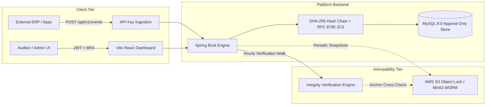

# AuditRail — Enterprise Tamper-Evident Audit Platform

AuditRail is an enterprise-grade, application-independent audit log platform engineered to provide mathematical certainty and tamper-evident evidentiary guarantees to compliance and security logging.

> **Important:** AuditRail is **NOT a blockchain**, has no cryptocurrency tokens or consensus overhead, and is not a generic SIEM/GRC wrapper. It is a high-performance **tamper-evident audit integrity ledger** built on sequential SHA-256 hash chaining and out-of-band Write-Once-Read-Many (WORM) storage anchors.

---

## 🚀 Zero-Setup Quickstart (Run in 1 Click)

Anyone cloning or downloading the repository can spin up the complete containerized stack in **one single command** (or double-click). No manual database installations, Java setups, or Node.js installs required.

### Option A: Double-Click (Windows)
1. Double-click [**`run_auditrail.bat`**](run_auditrail.bat)
2. The script will automatically:
   - Verify Docker Desktop is active.
   - Build and start all 4 containers (MySQL 8.0, MinIO S3 Object Lock, Backend, and Frontend).
   - Automatically open `http://localhost:5173` in your browser.

### Option B: Terminal / Linux / macOS (1 Command)
```bash
docker compose up -d --build
```
*(or run `./run_auditrail.sh` on macOS/Linux)*

---

### 🌐 Access URLs & Demo Credentials

| Component | URL | Credentials / Notes |
| :--- | :--- | :--- |
| **AuditRail Editorial UI** | `http://localhost:5173` *(or port 80)* | Ready to use immediately |
| **Backend API & Health** | `http://localhost:8080/api/v1/policy/dpdp` | Actuator & Ingestion API |
| **MinIO S3 Object Lock** | `http://localhost:9001` | User: `minioadmin` / Pass: `minioadminpassword2026!` |
| **Simulated Client Bank** | `http://localhost:5050` | Double-click `launch_simulated_client_app.bat` |

---

## 🌟 Key Highlights & Architectural Overview



### Core Cryptographic Capabilities
- **Level 1 (Internal Hash-Chain Walk):** Every record mathematically links to the SHA-256 digest of its exact predecessor under pessimistic row locking (`SELECT ... FOR UPDATE`), guaranteeing monotonic sequencing and immediate detection of dropped, inserted, or modified rows.
- **Level 2 (External WORM Anchoring):** Periodic state snapshots are exported to **AWS S3 Object Lock (Compliance Mode)**. Even a malicious DBA with root database access cannot rewrite the audit history without flagging external checkpoint mismatches.
- **Canonical Serialization (RFC 8785 JCS):** Deterministic JSON metadata sorting and microsecond timestamp normalization eliminate hashing discrepancies across different operating systems and languages.

---

## 🛠️ Complete Technology Stack

| Domain | Technology / Specification | Purpose |
| :--- | :--- | :--- |
| **Backend** | Java 17+, Spring Boot 3.3.5 | Modular monolith backend services |
| **Security** | Spring Security 6, JJWT 0.12.6, BCrypt (cost 12) | Stateless JWT authentication, role segregation, brute-force lockout |
| **MFA** | RFC 6238 TOTP (HMAC-SHA1, 30s) | Time-based one-time password two-factor authentication |
| **Database** | MySQL 8.0+ (InnoDB Engine) | Primary append-only audit event store with row-level pessimistic locking |
| **Database Migrations** | Flyway (`flyway-core`, `flyway-mysql`) | Version-controlled DDL migrations (`V1` schema, `V2` seed) |
| **Hashing Engine** | SHA-256 (NIST FIPS 180-4) | Monotonic cryptographic chaining and metadata digest calculation |
| **Serialization** | RFC 8785 JSON Canonicalization (JCS) | Deterministic key ordering and whitespace normalization |
| **Frontend UI** | React 18, TypeScript, Vite | Enterprise operator and audit explorer interface |
| **Styling & Fonts** | Tailwind CSS 3, Plus Jakarta Sans, JetBrains Mono | Obsidian charcoal palette (`#090D10`), high-contrast typography |
| **Cloud & Storage** | AWS S3 Object Lock, MinIO | Write-Once-Read-Many (WORM) out-of-band checkpoint storage |
| **Cloud Security** | AWS KMS, AWS IAM, Secrets Manager | Cryptographic key management and least-privilege service roles |
| **Auditing & Threat** | AWS CloudTrail, GuardDuty, Inspector | Multi-layer telemetry and infrastructure vulnerability scanning |
| **DevOps & IaC** | Docker, Docker Compose, Terraform | Reproducible multi-environment deployment orchestration |

---

## 📂 Project Directory Structure

```
AuditRail/
├── backend/                             # Spring Boot 3.3.5 Modular Monolith
│   ├── src/main/java/com/auditrail/
│   │   ├── controller/                  # REST Controllers (Auth, Events, Audit, Verification, Policy)
│   │   ├── dto/                         # Request & Response Contracts
│   │   ├── entity/                      # JPA Entities (Organization, User, ApiKey, AuditEvent, Checkpoint)
│   │   ├── exception/                   # Sanitized Global Exception Handlers
│   │   ├── repository/                  # Spring Data JPA Repositories (Pessimistic write locking)
│   │   ├── security/                    # JWT Filters, ApiKey Authentication, RBAC, Tenant Context
│   │   ├── service/                     # Service Interfaces & Implementations
│   │   ├── service/adapter/             # Storage Adapters (Local, MinIO, AWS S3)
│   │   └── util/                        # HashUtil, CanonicalJsonUtil (RFC 8785), CanonicalPayloadBuilder
│   └── src/main/resources/
│       ├── application.yml              # Base Spring Boot Configuration
│       ├── application-dev.yml          # Local In-Memory Development Configuration
│       └── db/migration/                # Flyway Migrations (V1 DDL, V2 Seed Data)
├── frontend/                            # React + TypeScript + Vite UI
│   ├── src/
│   │   ├── components/                  # Interactive Chaining Simulator & Visualizers
│   │   ├── types/                       # TypeScript Data Interfaces
│   │   ├── App.tsx                      # Landing Page & Audit Explorer
│   │   ├── index.css                    # Tailwind Directives & Custom Backdrops
│   │   └── main.tsx                     # Vite Entrypoint
│   └── tailwind.config.js               # Enterprise Obsidian Color Palette Config
├── database/                            # Reference Database DDL & Data Dictionaries
│   ├── schema.sql                       # Pure MySQL 8.0 DDL Schema
│   ├── data_dictionary.md               # Detailed Data Dictionary & Indexing Rationale
│   ├── hash_chain_spec.md               # Cryptographic Hash-Chain Specifications
│   └── test_cases.sql                   # SQL Integrity Validation Test Suite
├── docs/                                # Technical Architecture Documentation
│   └── architecture/
│       ├── 01_database_layer.md         # Database Schema, Entities, Constraints, & ERD
│       ├── 02_core_cryptography_and_flow.md # Ingestion Lifecycle, Canonicalization, Verification Walk
│       ├── 03_services_and_controllers.md  # All Controllers, Services, & API Specifications
│       └── 04_security_and_isolation.md    # Multi-Tenant Isolation, RBAC, TOTP, & DPDP Compliance
├── miscellaneous/
│   └── database_explanation.txt         # Non-technical explanation for team members
└── README.md                            # Comprehensive Platform Guide
```

---

## 🚀 Getting Started Locally

### Prerequisites
- **Java:** JDK 17 or higher
- **Maven:** 3.9+
- **Node.js:** 18+ & npm 9+
- **MySQL:** 8.0+ (or run with embedded H2 dev profile)

### 1. Running the Backend
To start the backend in local standalone mode:
```bash
cd backend
mvn spring-boot:run "-Dspring-boot.run.profiles=dev"
```
The backend starts at `http://localhost:8080/`.

### 2. Running the Frontend
```bash
cd frontend
npm install
npm run dev -- --host
```
Open your browser at `http://localhost:5173/`.

### 3. Running Automated Tests
AuditRail maintains unit and integration test suites covering concurrent ingestion, RFC 8785 canonical serialization, gap detection, row tampering, and checkpoint anchor verification:
```bash
cd backend
mvn test
```

---

## 🔐 Credentials & Demo Data

The platform comes pre-seeded with a demo tenant for testing:
- **Organization:** Acme Global Logistics (`slug: acme-global`, `id: 00000000-0000-0000-0000-000000000001`)
- **Demo Ingestion API Key:** `ar_live_demo01_acme_secret_key_9981`
- **Demo Admin:** `admin@acme-logistics.com` / `Admin@AuditRail2026!`
- **Demo Auditor:** `auditor@acme-logistics.com` / `Auditor@AuditRail2026!`

---

## 🏛️ Regulatory Compliance Mapping

- **Digital Personal Data Protection (DPDP) Act 2023 (Section 8(5), Section 9):** Enforces purpose-limited logging, cryptographically verified data modifications, and tenant isolation.
- **SOC 2 Type II (Trust Services Criteria CC6.1, CC6.8, CC7.2):** Continuous unalterable event tracking with hourly automated verification walks.
- **HIPAA / PCI-DSS:** Immutable audit trail preservation with multi-factor authentication for operators and cryptographic tamper alerts.

---

## 📄 License
This project is licensed under the MIT License.
