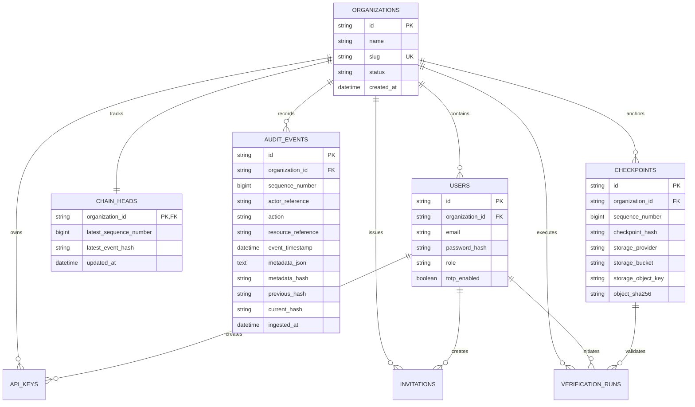

# AuditRail — Database Layer Architecture

This document details the database architecture, entity relationships, schema constraints, connection mechanisms, and transaction boundaries for AuditRail.

---

## 1. Relational Database Overview & Engine Specifications

- **Database Engine:** MySQL 8.0+ (InnoDB Storage Engine)
- **Character Set / Collation:** `utf8mb4` / `utf8mb4_unicode_ci`
- **Driver:** MySQL Connector/J (`com.mysql.cj.jdbc.Driver`)
- **Connection Pool:** HikariCP
- **Migration & Evolution:** Flyway (`V1__init_auditrail_schema.sql`, `V2__seed_demo_organization.sql`)

### Database Connection Configuration
In Spring Boot, the database connection is resolved via environment-driven properties in `application.yml`:
```yaml
spring:
  datasource:
    url: ${SPRING_DATASOURCE_URL:jdbc:mysql://localhost:3306/auditrail?useSSL=false&allowPublicKeyRetrieval=true&serverTimezone=UTC}
    username: ${SPRING_DATASOURCE_USERNAME:auditrail_app}
    password: ${SPRING_DATASOURCE_PASSWORD:auditrail_secret}
    driver-class-name: com.mysql.cj.jdbc.Driver
  jpa:
    hibernate:
      ddl-auto: validate
    properties:
      hibernate:
        dialect: org.hibernate.dialect.MySQLDialect
```

---

## 2. All Entities & Structural Specifications

AuditRail defines 8 core entity tables inside `com.auditrail.entity`:

### 1. `Organization` (`organizations`)
The root multi-tenant isolation boundary. Every user, API key, audit event, and checkpoint belongs strictly to an organization.
- `id` (VARCHAR(36), PK): UUID v4 tenant identifier.
- `name` (VARCHAR(128)): Legal entity or enterprise company name.
- `slug` (VARCHAR(64), UNIQUE): URL-safe tenant identifier.
- `status` (VARCHAR(32)): Organization status (`ACTIVE`, `SUSPENDED`, `DEACTIVATED`).
- `createdAt` / `updatedAt` (DATETIME(6)): Microsecond precision audit timestamps.

### 2. `User` (`users`)
Enterprise human operators authorized to access the system.
- `id` (VARCHAR(36), PK): UUID v4 identifier.
- `organizationId` (VARCHAR(36), FK -> `organizations.id`): Tenant isolation boundary.
- `email` (VARCHAR(255)): Corporate email address.
- `passwordHash` (VARCHAR(255)): BCrypt hashed password (work factor $\ge 12$).
- `role` (VARCHAR(32)): `ADMIN` (full control) or `AUDITOR` (read-only verification).
- `accountStatus` (VARCHAR(32)): `ACTIVE`, `DISABLED`, `PENDING_INVITE`.
- `totpSecretEncrypted` (VARCHAR(512)): AES-256-GCM encrypted Base32 TOTP secret.
- `totpEnabled` (BOOLEAN): MFA status flag.
- `totpVerifiedAt` (DATETIME(6)): MFA enrollment timestamp.
- `failedLoginAttempts` (INT): Brute-force lockout counter (locks at 5 attempts).
- `lockedUntil` (DATETIME(6)): Lockout expiration timestamp.
- **Unique Constraint:** `uq_users_org_email (organization_id, email)` (email uniqueness is scoped per tenant).

### 3. `ApiKey` (`api_keys`)
Machine-to-machine ingestion credentials for external systems (e.g. SAP ERP, AWS Lambda).
- `id` (VARCHAR(36), PK): UUID v4 identifier.
- `organizationId` (VARCHAR(36), FK -> `organizations.id`): Tenant isolation boundary.
- `keyPrefix` (VARCHAR(16)): Public routing prefix (e.g., `ar_live_a1b2c3d4`).
- `keyHash` (CHAR(64), UNIQUE): SHA-256 hex digest of the raw secret token. **Raw keys are never stored.**
- `label` (VARCHAR(128)): Human-readable descriptor of the calling service.
- `status` (VARCHAR(32)): `ACTIVE`, `REVOKED`.
- `createdByUserId` (VARCHAR(36), FK -> `users.id`).
- `lastUsedAt` (DATETIME(6)): Updated on every authenticated ingestion call.

### 4. `ChainHead` (`chain_heads`)
The cryptographic tail and concurrency anchor of each organization's hash chain.
- `organizationId` (VARCHAR(36), PK, FK -> `organizations.id`): 1:1 relationship with organization.
- `latestSequenceNumber` (BIGINT UNSIGNED): Current monotonic event counter.
- `latestEventHash` (CHAR(64)): SHA-256 digest of the latest appended event.
- `updatedAt` (DATETIME(6)): Timestamp of last sequence append.
- **Concurrency Mechanism:** Queried via `@Lock(LockModeType.PESSIMISTIC_WRITE)` (`SELECT ... FOR UPDATE`) during event ingestion to enforce serial sequence assignment without race conditions.

### 5. `AuditEvent` (`audit_events`)
The immutable, append-only ledger of business and security events.
- `id` (VARCHAR(36), PK): UUID v4 event identifier.
- `organizationId` (VARCHAR(36), FK -> `organizations.id`): Tenant boundary.
- `sequenceNumber` (BIGINT UNSIGNED): Strictly monotonic integer sequence per organization (1, 2, 3, ...).
- `actorReference` (VARCHAR(255)): Originator identity (e.g. `user:elena.rostova`, `system:cron`).
- `action` (VARCHAR(128)): Action code (e.g. `PAYMENT_RECONCILIATION`, `USER_LOGIN`).
- `resourceReference` (VARCHAR(255)): Target entity (e.g. `invoice:inv_99812`).
- `eventTimestamp` (DATETIME(6)): Client-side occurrence timestamp (UTC, microsecond truncated).
- `metadataJson` (TEXT / JSON): RFC 8785 canonicalized JSON attributes.
- `metadataHash` (CHAR(64)): SHA-256 hex digest of the canonical metadata JSON.
- `previousHash` (CHAR(64)): SHA-256 digest of event `(sequence_number - 1)` (or 64 hex zeros for Genesis).
- `currentHash` (CHAR(64)): SHA-256 digest of `v1|orgId|seq|actor|action|resource|time|metaHash|prevHash`.
- `ingestedAt` (DATETIME(6)): Server ingestion timestamp.
- **Unique Constraints:** `(organization_id, sequence_number)`, `(organization_id, current_hash)`.

### 6. `Checkpoint` (`checkpoints`)
Periodic snapshots exported to independent Write-Once-Read-Many (WORM) storage.
- `id` (VARCHAR(36), PK): UUID v4 identifier.
- `organizationId` (VARCHAR(36), FK -> `organizations.id`).
- `sequenceNumber` (BIGINT UNSIGNED): Chain head sequence anchored at snapshot time.
- `checkpointHash` (CHAR(64)): SHA-256 event hash anchored at that sequence.
- `hashAlgorithm` (VARCHAR(32)): `SHA-256`.
- `storageProvider` (VARCHAR(32)): `LOCAL`, `MINIO`, `S3`.
- `storageBucket` (VARCHAR(128)): Target bucket name (e.g. `auditrail-checkpoints`).
- `storageObjectKey` (VARCHAR(255)): Full path key (e.g. `checkpoints/org-id/cp_seq_100.json`).
- `objectVersionReference` (VARCHAR(128)): S3 Object Lock version ID.
- `objectSha256` (CHAR(64)): SHA-256 digest of the raw exported JSON file.
- `verificationStatus` (VARCHAR(32)): `VERIFIED`, `FAILED`.

### 7. `Invitation` (`invitations`)
Single-use tenant invitations for adding new administrators and auditors.
- `id` (VARCHAR(36), PK): UUID v4 identifier.
- `organizationId` (VARCHAR(36), FK -> `organizations.id`).
- `email` (VARCHAR(255)): Invitee destination email.
- `role` (VARCHAR(32)): Assigned role (`ADMIN` or `AUDITOR`).
- `tokenHash` (CHAR(64), UNIQUE): SHA-256 hash of single-use invitation token.
- `expiresAt` (DATETIME(6)): Expiration timestamp (48-hour TTL).
- `acceptedAt` (DATETIME(6)): Timestamp when redeemed.

### 8. `VerificationRun` (`verification_runs`)
Audit records detailing every manual and automated chain walk execution.
- `id` (VARCHAR(36), PK): UUID v4 identifier.
- `organizationId` (VARCHAR(36), FK -> `organizations.id`).
- `triggerType` (VARCHAR(32)): `MANUAL`, `SCHEDULED_HOURLY`, `EXTERNAL_API`.
- `initiatedByUserId` (VARCHAR(36), FK -> `users.id`, NULL for scheduled runs).
- `startedAt` / `completedAt` (DATETIME(6)).
- `startSequenceNumber` / `endSequenceNumber` (BIGINT UNSIGNED).
- `totalEventsChecked` (BIGINT UNSIGNED).
- `result` (VARCHAR(32)): `VERIFIED`, `FAILED`, `CHECKPOINT_UNAVAILABLE`, `PENDING`.
- `checkpointId` (VARCHAR(36), FK -> `checkpoints.id`).
- `failureSequenceNumber` (BIGINT UNSIGNED): Exact sequence where tampering or gap was detected.
- `failureReason` (VARCHAR(512)): Human-readable verification error.
- `failureDetails` (TEXT): Structured JSON diagnostics of the failure.

---

## 3. Entity Relationship Diagram (ERD)



---

## 4. Transaction Boundaries & Concurrency Architecture

### Event Ingestion Lock Lifecycle
During `AuditEventIngestionService.ingestEvent(organizationId, request)`:
1. **Isolation Level:** `Isolation.READ_COMMITTED`
2. **Lock Acquisition:** `ChainHeadRepository.findByOrganizationIdForUpdate(organizationId)` issues:
   ```sql
   SELECT organization_id, latest_sequence_number, latest_event_hash, updated_at 
   FROM chain_heads 
   WHERE organization_id = ? 
   FOR UPDATE;
   ```
3. **Sequence & Hash Derivation:** Reads `latest_sequence_number + 1` and `previous_hash`.
4. **Append:** Inserts new row into `audit_events`.
5. **Head Update:** Updates `chain_heads` with new sequence and current event hash.
6. **Commit & Lock Release:** Releasing the lock for subsequent concurrent threads.
