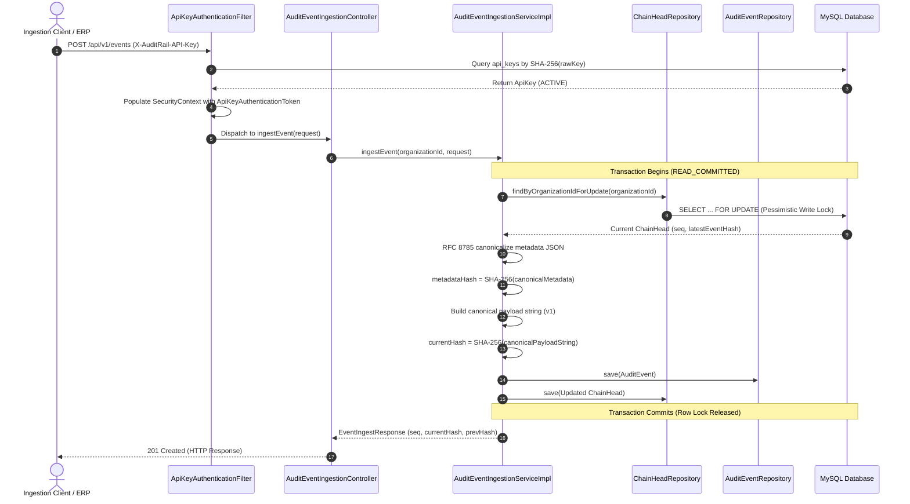
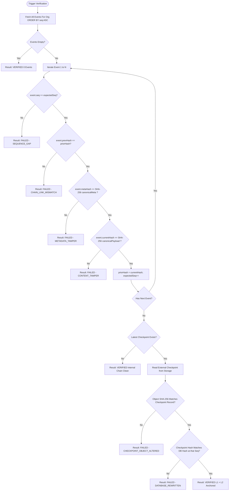

# AuditRail — Core Cryptography & Ingestion Flow

This document details the exact cryptographic algorithms, serialization standards, deterministic hash payload structures, and verification workflows implemented in AuditRail.

---

## 1. Cryptographic Principles & Standards

AuditRail is **NOT a blockchain**, uses **NO proof-of-work/stake**, and issues **NO distributed tokens**. It is an enterprise-grade **tamper-evident audit logging platform** based on two cryptographic pillars:
1. **SHA-256 Monotonic Chaining:** Every row mathematically seals the cryptographic digest of its exact predecessor.
2. **RFC 8785 Canonical Serialization:** JSON metadata is normalized deterministically before hashing.

### Algorithms Used
- **Hash Function:** SHA-256 (`MessageDigest.getInstance("SHA-256")` via `HashUtil.java`), outputting a lowercase 64-character hexadecimal digest.
- **Constant-Time Comparison:** `MessageDigest.isEqual(...)` via `HashUtil.constantTimeEquals(a, b)` to defend against timing side-channel attacks during hash verification.
- **Genesis State Constant:**
  ```java
  public static final String GENESIS_HASH = 
      "0000000000000000000000000000000000000000000000000000000000000000";
  ```

---

## 2. Ingestion Flow (Step-by-Step)

When an external client sends a `POST /api/v1/events` request with header `X-AuditRail-API-Key`:



---

## 3. Canonical Payload Format (v1 Specification)

To prevent discrepancies caused by spacing, field order, escaping, or time representations, AuditRail defines the **v1 canonical payload format**:

```
v1|organizationId|sequenceNumber|escapedActor|safeAction|escapedResource|isoTimestamp|metadataHash|previousHash
```

### Formatting & Escaping Rules
1. **Version Prefix:** Always `v1`.
2. **Field Delimiter:** Pipe character (`|`).
3. **Escaping Rule:** Literal backslashes (`\`) are replaced with `\\`, and literal pipes (`|`) are replaced with `\|`.
4. **Action Normalization:** Trimmed and converted to uppercase (`.trim().toUpperCase()`).
5. **Timestamp Precision:** Truncated to microseconds (`truncatedTo(ChronoUnit.MICROS)`) and serialized as standard ISO-8601 UTC string (e.g., `2026-11-20T16:00:00.123456Z`).
6. **Hash Fields:** `metadataHash` and `previousHash` are normalized to lowercase 64-character hex strings.

### RFC 8785 JSON Canonicalization (JCS)
Handled by `CanonicalJsonUtil.java`:
- Key sorting: Object keys are strictly sorted by Unicode code point order using a `TreeMap<String, JsonNode>`.
- Whitespace: All non-semantic whitespace is stripped.
- Number format: Serialized without trailing zeros or unnecessary exponent signs.

---

## 4. Verification Flow & Tamper Detection

The verification engine (`IntegrityVerificationServiceImpl`) supports two levels of audit:



### Detection Guarantees
- **Deleted Record:** A missing sequence number immediately triggers a `SEQUENCE_GAP` failure.
- **Modified Field:** Any alteration to actor, action, timestamp, or metadata invalidates `CONTENT_TAMPER` or `METADATA_TAMPER`.
- **Database Rewrite:** If an attacker with DBA privileges updates the entire database and recalculates all hashes, the out-of-band WORM checkpoint stored in AWS S3 Object Lock rejects the verification with `DATABASE_REWRITTEN`.
