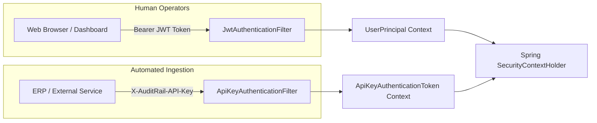
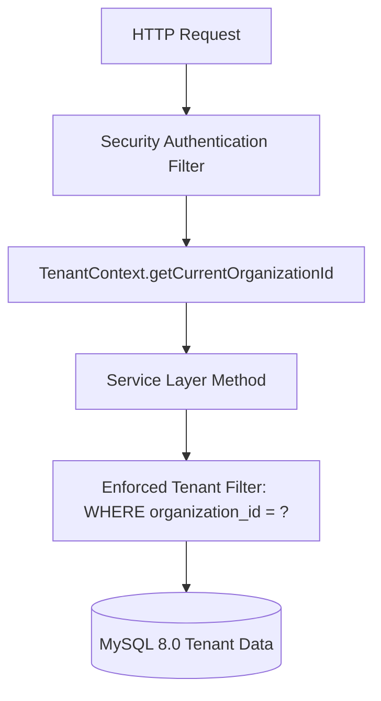

# AuditRail — Security Architecture & Multi-Tenant Isolation

This document details the multi-tenant isolation boundaries, authentication mechanisms, authorization matrix, and data protection safeguards implemented in AuditRail.

---

## 1. Authentication Mechanisms

AuditRail implements dual-channel authentication tailored to enterprise human operators and automated external systems:

### 1. Enterprise User Authentication (JWT + TOTP MFA)
- **Password Storage:** Salted BCrypt with cost factor 12 (`new BCryptPasswordEncoder(12)`).
- **Brute-Force Protection:**
  - Tracks `failed_login_attempts`.
  - Automatically locks user account for 15 minutes after 5 consecutive failed attempts.
- **MFA Protocol:** Time-Based One-Time Password (TOTP, RFC 6238) using HMAC-SHA1 with 30-second window step.
- **Session Tokens:** Stateless JSON Web Tokens (JWT) signed via HMAC-SHA256 (`jjwt` 0.12.6) with 24-hour expiration.

### 2. Machine Ingestion Authentication (`X-AuditRail-API-Key`)
- External clients present a raw secret header: `X-AuditRail-API-Key: ar_live_demo01_acme_secret_key_9981`.
- `ApiKeyAuthenticationFilter` intercepts the request:
  1. Computes `SHA-256(raw_key)`.
  2. Queries `api_keys` where `key_hash = ?` and `status = 'ACTIVE'`.
  3. Updates `last_used_at` asynchronously.
  4. Automatically resolves the calling `organization_id`.
  5. Assigns `ROLE_INGEST` authority.

---

## 2. Multi-Tenant Isolation Architecture

AuditRail enforces **strict tenant query boundaries**:

### Key Isolation Rules
1. **Never Trust Client Tenant Input:** Callers cannot pass an `organization_id` parameter to ingest or query events. The tenant ID is derived exclusively from the authenticated session context (`TenantContext.getCurrentOrganizationId()`).
2. **Schema-Level Constraints:**
   - Every table except `organizations` contains an `organization_id` foreign key.
   - Every unique constraint is composite with `organization_id` (e.g. `(organization_id, sequence_number)`, `(organization_id, email)`).
3. **Pessimistic Chain Locking per Tenant:** Row locking occurs strictly on the organization's unique `chain_heads` row. Ingestion traffic in Organization A never blocks or contends with Organization B.

---

## 3. Role-Based Access Control (RBAC) Matrix

| Endpoint Group | Method | Path | Anonymous | `ROLE_INGEST` (API Key) | `ROLE_AUDITOR` | `ROLE_ADMIN` |
| :--- | :---: | :--- | :---: | :---: | :---: | :---: |
| Authentication | POST | `/api/v1/auth/login` | ✅ | ❌ | ❌ | ❌ |
| MFA Verification| POST | `/api/v1/auth/totp/verify` | ✅ | ❌ | ❌ | ❌ |
| Policy Disclosure | GET | `/api/v1/policy/dpdp` | ✅ | ✅ | ✅ | ✅ |
| Event Ingestion | POST | `/api/v1/events` | ❌ | ✅ | ❌ | ❌ |
| Audit Explorer | GET | `/api/v1/audit/**` | ❌ | ✅ | ✅ | ✅ |
| Verification Engine | POST/GET | `/api/v1/verification/**` | ❌ | ✅ | ✅ | ✅ |
| Checkpoints | POST/GET | `/api/v1/checkpoints/**` | ❌ | ✅ | ✅ | ✅ |
| Key Management | ALL | `/api/v1/api-keys/**` | ❌ | ❌ | ❌ | ✅ |
| User Admin | ALL | `/api/v1/users/**` | ❌ | ❌ | ❌ | ✅ |
| Invitations | POST | `/api/v1/invitations` | ❌ | ❌ | ❌ | ✅ |
| Redeem Invitation | POST | `/api/v1/invitations/redeem` | ✅ | ❌ | ❌ | ❌ |

---

## 4. Regulatory Compliance & Data Safeguards

### DPDP Act 2023 Compliance
- **Section 8(5) (Reasonable Security Safeguards):** Provided by cryptographic SHA-256 chaining and immutable WORM backups.
- **Section 9 (Personal Data Integrity):** Canonical RFC 8785 metadata guarantees data authenticity.
- **Audit Non-Repudiation:** Actor identities and timestamps cannot be retroactively altered without invalidating all subsequent events in the chain.

### Security Exception Sanitization
The platform implements a centralized `GlobalExceptionHandler`:
- Database errors (e.g., `SQLException`, `ConstraintViolationException`) are never exposed to callers.
- Sanitized, structured error envelopes are returned with UTC timestamps and generic security error codes.
